# Small Office Network

A two-department office network designed, built and tested in **Cisco Packet Tracer**. It combines VLAN segmentation, inter-VLAN routing (router-on-a-stick), HSRP gateway redundancy, an EtherChannel trunk, DNS/HTTP/FTP services, and a Cisco ASA firewall with NAT/PAT and default-deny security in front of a simulated Internet.

Everything here is a simulation; no real hardware was used.

## Table of contents

- [Overview](#overview)
- [Topology](#topology)
- [Devices](#devices)
- [Addressing plan](#addressing-plan)
- [Cabling](#cabling)
- [Configuration](#configuration)
- [How to reproduce and verify](#how-to-reproduce-and-verify)
- [Test results](#test-results)
- [HSRP failover test](#hsrp-failover-test)
- [Design decisions](#design-decisions)
- [Troubleshooting and lessons learned](#troubleshooting-and-lessons-learned)
- [Implemented vs planned](#implemented-vs-planned)
- [Limitations](#limitations)
- [Possible future improvements](#possible-future-improvements)
- [Repository structure](#repository-structure)
- [How to open the project](#how-to-open-the-project)
- [Author](#author)

## Overview

| Item | Value |
|---|---|
| Tool | Cisco Packet Tracer |
| Departments | 2 (Dept A and Dept B), 4 PCs each |
| VLANs | 10 (DEPT-A), 20 (DEPT-B), 30 (SERVERS), plus VLAN 1 as the router-to-firewall transit segment |
| Subnetting | One /28 (255.255.255.240) per VLAN, all inside 192.168.0.0/26 |
| Inter-VLAN routing | Router-on-a-stick on two Cisco 2911 routers |
| Gateway redundancy | HSRP: R1 active (priority 110, preempt), R2 standby (priority 100, preempt) |
| Switch-to-switch link | 2-link EtherChannel (Port-channel 1) on Fa0/23 and Fa0/24 |
| Services | DNS (`web.lab`), HTTP, FTP |
| Firewall | Cisco ASA 5506-X: PAT on the outside interface, default-deny from outside to inside |
| Internet | Simulated by a 2911 "ISP" router with a loopback (198.51.100.1) |

**Goals of the project**

1. Separate the two departments and the servers into their own VLANs and subnets.
2. Route between the VLANs through a redundant gateway, so that losing one router does not cut the PCs off.
3. Provide name resolution, a web server and a file server that both departments share.
4. Reach a simulated Internet through a firewall that translates addresses (NAT/PAT) and blocks unsolicited inbound traffic.

## Topology

*Figure 1. Final topology as built in Packet Tracer.*

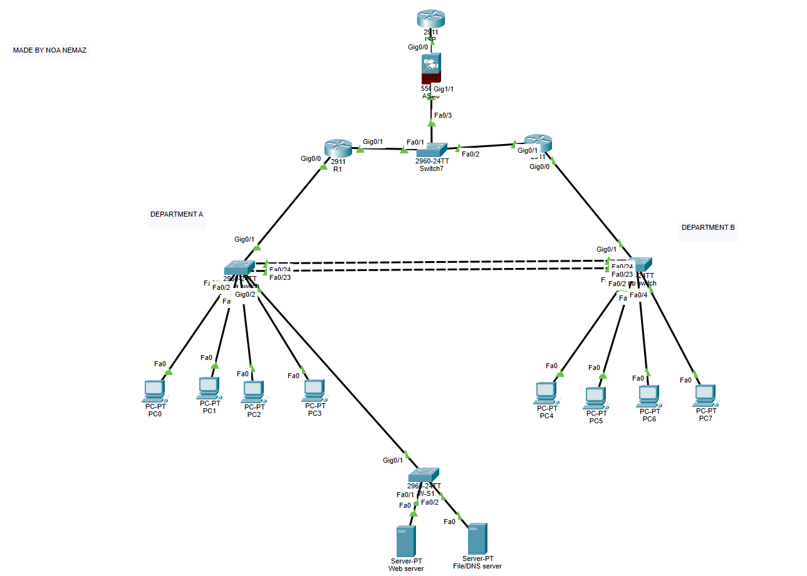

*Figure 2. The firewall segment. R1, R2 and the firewall's inside interface share one switch.*

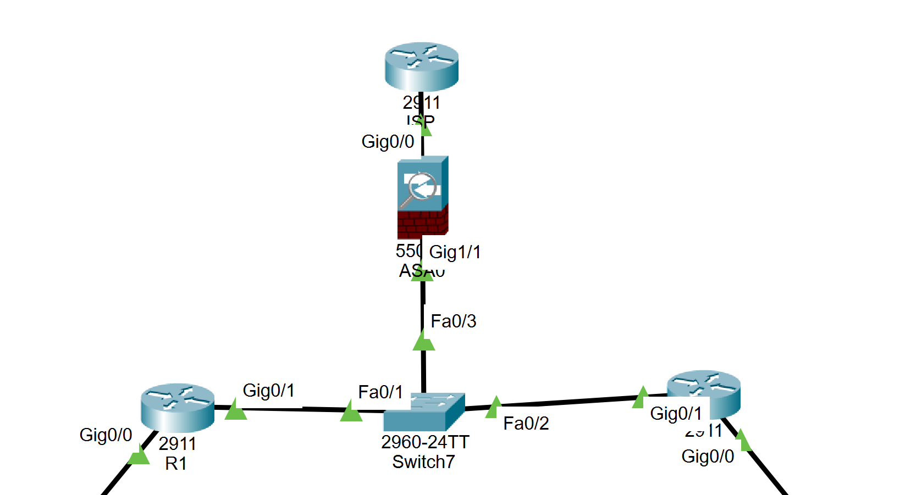

## Devices

| Device | Model | Role |
|---|---|---|
| PC0 to PC3 | PC-PT | Department A hosts |
| PC4 to PC7 | PC-PT | Department B hosts |
| dept a switch (hostname `SW1`) | Cisco 2960-24TT | Dept A access switch, VLAN 10, uplink to R1 and to SW-S1 |
| dept b switch (hostname `SW2`) | Cisco 2960-24TT | Dept B access switch, VLAN 20, uplink to R2 |
| SW-S1 | Cisco 2960-24TT | Server switch, VLAN 30 |
| SW-FW (labelled `Switch7` in Packet Tracer) | Cisco 2960-24TT | Unconfigured switch that gives R1, R2 and the firewall one shared segment (default VLAN 1) |
| R1 | Cisco 2911 | Gateway router, HSRP **active** |
| R2 | Cisco 2911 | Gateway router, HSRP **standby** |
| FW (labelled `ASA0` in Packet Tracer) | Cisco ASA 5506-X, ASA 9.6(1) | Firewall: NAT/PAT, default-deny |
| ISP | Cisco 2911 | Simulated Internet |
| Web server | Server-PT | HTTP |
| File/DNS server | Server-PT | DNS and FTP |

## Addressing plan

Every subnet uses the mask **255.255.255.240 (/28)**. One VLAN is one subnet.

### Subnets and gateways

| VLAN | Name | Subnet | HSRP virtual gateway | R1 real address | R2 real address | Hosts |
|---|---|---|---|---|---|---|
| 10 | DEPT-A | 192.168.0.0/28 | 192.168.0.1 (group 10) | 192.168.0.13 | 192.168.0.14 | PC0 to PC3 = 192.168.0.2 to .5 |
| 20 | DEPT-B | 192.168.0.16/28 | 192.168.0.17 (group 20) | 192.168.0.29 | 192.168.0.30 | PC4 to PC7 = 192.168.0.18 to .21 |
| 30 | SERVERS | 192.168.0.32/28 | 192.168.0.33 (group 30) | 192.168.0.45 | 192.168.0.46 | Web server .34, File/DNS server .35 |
| 1 (transit) | Routers to firewall | 192.168.0.48/28 | 192.168.0.52 (group 40) | 192.168.0.50 | 192.168.0.51 | FW inside = 192.168.0.49 |

| Link | Subnet | Addresses |
|---|---|---|
| Firewall outside to ISP | 203.0.113.0/30 | ISP Gi0/0 = 203.0.113.1, FW outside (Gi1/2) = 203.0.113.2 |
| Simulated public host | 198.51.100.1/32 | Loopback0 on the ISP router |

### Host settings

| Device | IP address | Mask | Default gateway | DNS server |
|---|---|---|---|---|
| PC0 | 192.168.0.2 | 255.255.255.240 | 192.168.0.1 | 192.168.0.35 |
| PC1 | 192.168.0.3 | 255.255.255.240 | 192.168.0.1 | 192.168.0.35 |
| PC2 | 192.168.0.4 | 255.255.255.240 | 192.168.0.1 | 192.168.0.35 |
| PC3 | 192.168.0.5 | 255.255.255.240 | 192.168.0.1 | 192.168.0.35 |
| PC4 | 192.168.0.18 | 255.255.255.240 | 192.168.0.17 | 192.168.0.35 |
| PC5 | 192.168.0.19 | 255.255.255.240 | 192.168.0.17 | 192.168.0.35 |
| PC6 | 192.168.0.20 | 255.255.255.240 | 192.168.0.17 | 192.168.0.35 |
| PC7 | 192.168.0.21 | 255.255.255.240 | 192.168.0.17 | 192.168.0.35 |
| Web server | 192.168.0.34 | 255.255.255.240 | 192.168.0.33 | 192.168.0.35 |
| File/DNS server | 192.168.0.35 | 255.255.255.240 | 192.168.0.33 | 192.168.0.35 |

DNS record on the File/DNS server: `web.lab` (A record) pointing to 192.168.0.34.

*Figure 3. Example Dept A host (PC3).*

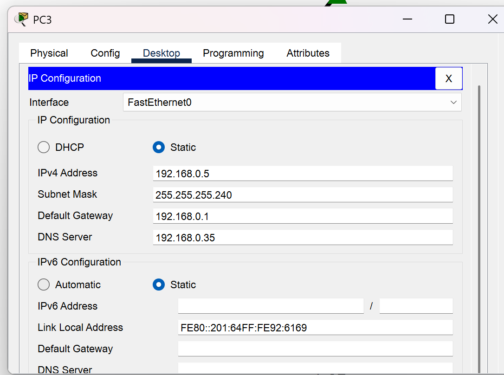

*Figure 4. Example Dept B host (PC4).*

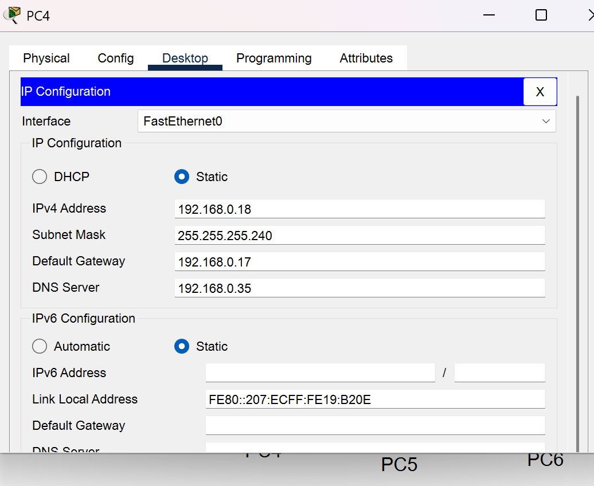

*Figure 5. Web server settings: static default gateway 192.168.0.33 and DNS server 192.168.0.35 (Config tab, global settings).*

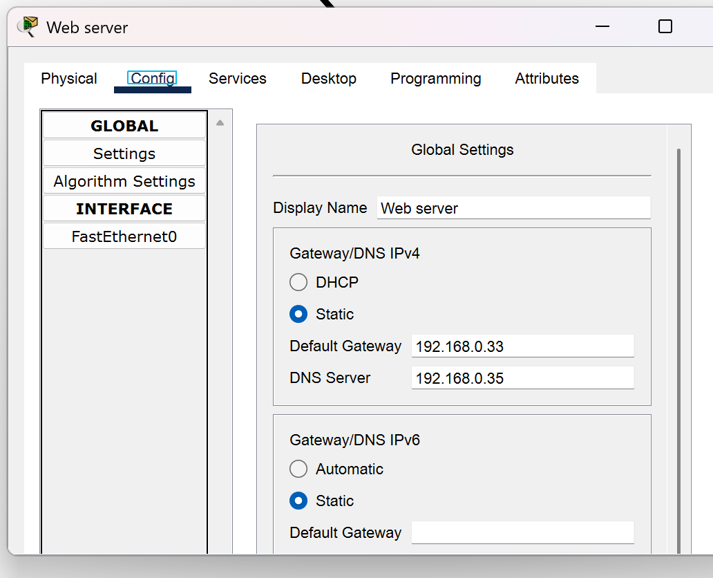

*Figure 6. File/DNS server addressing.*

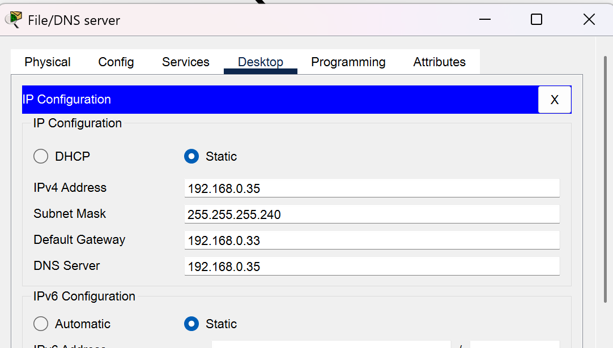

### Why a /28?

The mask 255.255.255.240 cuts the address space into blocks of 16 addresses, of which 14 are usable for hosts. That is plenty for 4 PCs plus three gateway addresses per department, and it keeps the plan easy to read:

| Block | Range | Used for |
|---|---|---|
| 192.168.0.0/28 | .0 to .15 | Dept A |
| 192.168.0.16/28 | .16 to .31 | Dept B |
| 192.168.0.32/28 | .32 to .47 | Servers |
| 192.168.0.48/28 | .48 to .63 | Routers to firewall |

Each department has to be a *different* subnet, so Dept B starts at 192.168.0.16. Continuing the numbering at .6 or .7 would be a mistake, because those addresses are still inside Dept A's /28 and both departments would end up in the same subnet.

Two further choices follow from this layout:

- **Hosts low, routers high.** PCs and servers take the lowest addresses of each block and the virtual gateway takes the first one (.1, .17, .33). The routers' real addresses sit at the top of each block (.13/.14, .29/.30, .45/.46), out of the way of the hosts.
- **One summary route.** The four /28 blocks together are exactly 192.168.0.0/26 (255.255.255.192), so the firewall needs only one route and one NAT rule for the whole inside network.

## Cabling

| From | To | Link type |
|---|---|---|
| R1 Gi0/0 | dept a switch Gi0/1 | 802.1Q trunk |
| R2 Gi0/0 | dept b switch Gi0/1 | 802.1Q trunk |
| dept a switch Fa0/23 and Fa0/24 | dept b switch Fa0/23 and Fa0/24 | 2-link EtherChannel (Po1), trunk, crossover cables |
| dept a switch Gi0/2 | SW-S1 Gi0/1 | 802.1Q trunk |
| PC0 to PC3 | dept a switch Fa0/1 to Fa0/4 | Access, VLAN 10 |
| PC4 to PC7 | dept b switch Fa0/1 to Fa0/4 | Access, VLAN 20 |
| Web server | SW-S1 Fa0/1 | Access, VLAN 30 |
| File/DNS server | SW-S1 Fa0/2 | Access, VLAN 30 |
| R1 Gi0/1 | SW-FW Fa0/1 | Transit (VLAN 1) |
| R2 Gi0/1 | SW-FW Fa0/2 | Transit (VLAN 1) |
| FW Gi1/1 (inside) | SW-FW Fa0/3 | Transit (VLAN 1) |
| FW Gi1/2 (outside) | ISP Gi0/0 | Routed point-to-point link |

## Configuration

Click a device to expand its configuration. No passwords are configured in this lab (see [Limitations](#limitations)).

<details>
<summary><strong>dept a switch (SW1)</strong></summary>

```text
enable
configure terminal
hostname SW1
vlan 10
 name DEPT-A
vlan 20
 name DEPT-B
vlan 30
 name SERVERS
exit
interface range fa0/1-4
 switchport mode access
 switchport access vlan 10
exit
interface range fa0/23-24
 switchport mode trunk
 channel-group 1 mode active
exit
interface port-channel 1
 switchport mode trunk
exit
interface gi0/1
 switchport mode trunk
exit
interface gi0/2
 switchport mode trunk
end
write memory
```

VLAN 20 and VLAN 30 are defined here even though no local port uses them, because their traffic crosses this switch on the trunks.

</details>

<details>
<summary><strong>dept b switch (SW2)</strong></summary>

Identical to SW1 except for the hostname, the access VLAN, and the missing Gi0/2 trunk (only Gi0/1 and Po1 are trunks here).

```text
enable
configure terminal
hostname SW2
vlan 10
 name DEPT-A
vlan 20
 name DEPT-B
vlan 30
 name SERVERS
exit
interface range fa0/1-4
 switchport mode access
 switchport access vlan 20
exit
interface range fa0/23-24
 switchport mode trunk
 channel-group 1 mode active
exit
interface port-channel 1
 switchport mode trunk
exit
interface gi0/1
 switchport mode trunk
end
write memory
```

</details>

<details>
<summary><strong>SW-S1 (server switch)</strong></summary>

```text
enable
configure terminal
hostname SW-S1
vlan 10
 name DEPT-A
vlan 20
 name DEPT-B
vlan 30
 name SERVERS
exit
interface range fa0/1-2
 switchport mode access
 switchport access vlan 30
exit
interface gi0/1
 switchport mode trunk
end
write memory
```

</details>

<details>
<summary><strong>SW-FW (shared switch)</strong></summary>

No configuration. All ports stay in the default VLAN 1, so R1 Gi0/1, R2 Gi0/1 and the firewall's inside interface are simply in one broadcast domain.

</details>

<details>
<summary><strong>R1 (HSRP active, priority 110)</strong></summary>

LAN side, one sub-interface per VLAN:

```text
enable
configure terminal
hostname R1
interface gi0/0
 no shutdown
exit
interface gi0/0.10
 encapsulation dot1Q 10
 ip address 192.168.0.13 255.255.255.240
 standby 10 ip 192.168.0.1
 standby 10 priority 110
 standby 10 preempt
exit
interface gi0/0.20
 encapsulation dot1Q 20
 ip address 192.168.0.29 255.255.255.240
 standby 20 ip 192.168.0.17
 standby 20 priority 110
 standby 20 preempt
exit
interface gi0/0.30
 encapsulation dot1Q 30
 ip address 192.168.0.45 255.255.255.240
 standby 30 ip 192.168.0.33
 standby 30 priority 110
 standby 30 preempt
end
write memory
```

Firewall side (transit segment) and default route:

```text
configure terminal
track 1 interface gi0/0 line-protocol
interface gi0/1
 ip address 192.168.0.50 255.255.255.240
 standby 40 ip 192.168.0.52
 standby 40 priority 110
 standby 40 preempt
 standby 40 track 1 decrement 20
 no shutdown
exit
ip route 0.0.0.0 0.0.0.0 192.168.0.49
end
write memory
```

The tracking lines are there because R1's Gi0/1 stays up when its LAN interface Gi0/0 fails. Without tracking, R1 would keep the virtual address 192.168.0.52 even though it can no longer reach the LAN. With tracking, R1's group 40 priority drops from 110 to 90, below R2's 100, and R2 takes over the virtual address.

</details>

<details>
<summary><strong>R2 (HSRP standby, default priority 100)</strong></summary>

Same structure as R1 with its own real addresses. There are no `priority` lines, so R2 uses the HSRP default of 100; `preempt` is kept.

```text
enable
configure terminal
hostname R2
interface gi0/0
 no shutdown
exit
interface gi0/0.10
 encapsulation dot1Q 10
 ip address 192.168.0.14 255.255.255.240
 standby 10 ip 192.168.0.1
 standby 10 preempt
exit
interface gi0/0.20
 encapsulation dot1Q 20
 ip address 192.168.0.30 255.255.255.240
 standby 20 ip 192.168.0.17
 standby 20 preempt
exit
interface gi0/0.30
 encapsulation dot1Q 30
 ip address 192.168.0.46 255.255.255.240
 standby 30 ip 192.168.0.33
 standby 30 preempt
exit
interface gi0/1
 ip address 192.168.0.51 255.255.255.240
 standby 40 ip 192.168.0.52
 standby 40 preempt
 no shutdown
exit
ip route 0.0.0.0 0.0.0.0 192.168.0.49
end
write memory
```

</details>

<details>
<summary><strong>FW (Cisco ASA 5506-X)</strong></summary>

Relevant part of `show running-config`:

```text
hostname FW
interface GigabitEthernet1/1
 nameif inside
 security-level 100
 ip address 192.168.0.49 255.255.255.240
interface GigabitEthernet1/2
 nameif outside
 security-level 0
 ip address 203.0.113.2 255.255.255.252
object network INSIDE-NET
 subnet 192.168.0.0 255.255.255.192
 nat (inside,outside) dynamic interface
access-list OUTSIDE-IN extended permit icmp any any echo-reply
access-group OUTSIDE-IN in interface outside
route outside 0.0.0.0 0.0.0.0 203.0.113.1 1
route inside 192.168.0.0 255.255.255.192 192.168.0.50 1
policy-map global_policy
 class inspection_default
  inspect dns preset_dns_map
  inspect ftp
  inspect icmp
  inspect tftp
service-policy global_policy global
```

Interfaces Gi1/3 to Gi1/8 and Management1/1 are shut down.

- **One object for everything inside.** `192.168.0.0 255.255.255.192` (/26) covers the three VLAN subnets and the transit subnet.
- **PAT.** `nat (inside,outside) dynamic interface` makes every inside host share the outside address 203.0.113.2.
- **Default-deny.** It comes from the security levels: traffic from inside (100) to outside (0) is allowed, traffic from outside to inside is blocked unless it is explicitly permitted. The only thing permitted is returning ICMP echo replies (access list `OUTSIDE-IN`), so that pings from inside get their answers.
- **Route back inside.** The inside route points at R1's real address 192.168.0.50 rather than the HSRP virtual address 192.168.0.52. This was part of the fix described under [Troubleshooting and lessons learned](#troubleshooting-and-lessons-learned), and it means return traffic from the Internet depends on R1.

</details>

<details>
<summary><strong>ISP (simulated Internet)</strong></summary>

```text
hostname ISP
interface gi0/0
 ip address 203.0.113.1 255.255.255.252
 no shutdown
interface loopback0
 ip address 198.51.100.1 255.255.255.255
```

The ISP needs no route back to the office. After PAT, all traffic arrives from 203.0.113.2, which is directly connected.

</details>

<details>
<summary><strong>Servers and services</strong></summary>

| Server | Service | Setting |
|---|---|---|
| Web server (192.168.0.34) | HTTP | On (HTTPS is also on, the Packet Tracer default) |
| File/DNS server (192.168.0.35) | DNS | On, one A record: `web.lab` to 192.168.0.34 |
| File/DNS server (192.168.0.35) | FTP | On |

</details>

*Figure 7. DNS service and the `web.lab` record.*

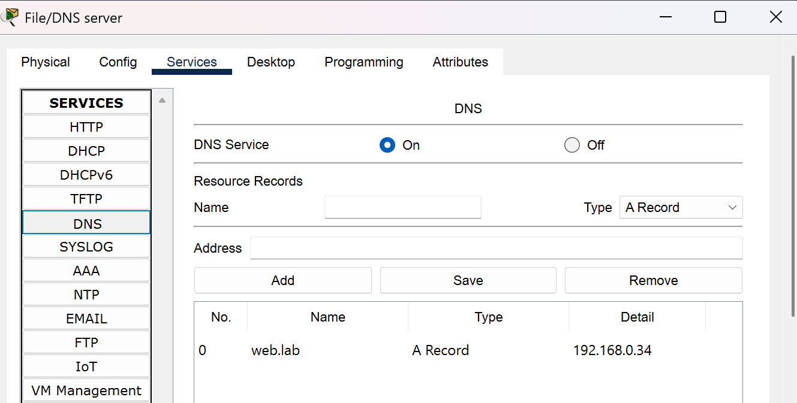

*Figure 8. HTTP service on the Web server.*

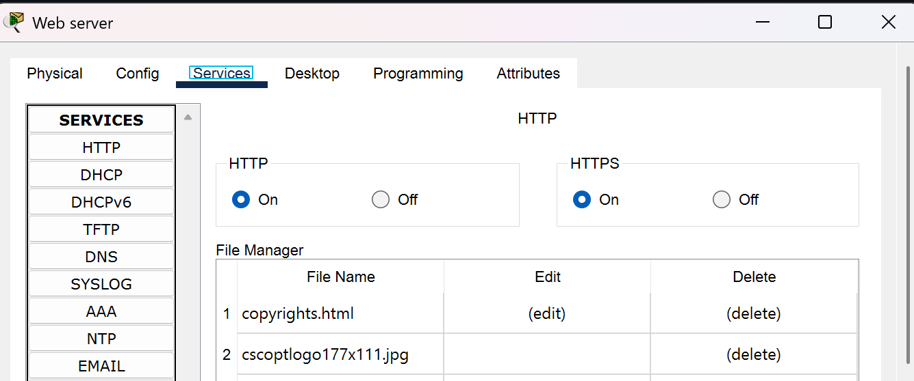

## How to reproduce and verify

Build the topology from the [Devices](#devices) and [Cabling](#cabling) tables, apply the [Configuration](#configuration), then check each layer from the bottom up. Commands such as `show standby brief` need privileged mode (the `#` prompt), so type `enable` first.

| # | Where | Command | Expected result |
|---|---|---|---|
| 1 | SW1, SW2, SW-S1 | `show vlan brief` | VLANs 10, 20 and 30 exist. PC ports Fa0/1 to Fa0/4 are in VLAN 10 (SW1) or VLAN 20 (SW2); Fa0/1 and Fa0/2 on SW-S1 are in VLAN 30 |
| 2 | SW1, SW2, SW-S1 | `show interfaces trunk` | Uplinks are trunking with 802.1q and carry VLANs 1, 10, 20, 30 |
| 3 | SW1, SW2 | `show etherchannel summary` | Po1 is in use with Fa0/23 and Fa0/24 bundled |
| 4 | R1, R2 | `show ip interface brief` | Gi0/0 and its three sub-interfaces are up/up with the addresses from the addressing plan; Gi0/1 is up/up |
| 5 | R1, R2 | `show standby brief` | R1 is Active and R2 is Standby for groups 10, 20, 30 and 40 |
| 6 | R1, R2 | `show ip route` | Four connected /28 networks and `S* 0.0.0.0/0 via 192.168.0.49` |
| 7 | PC1 | `ping 192.168.0.2` | Replies with TTL=128 (same subnet, no router crossed) |
| 8 | PC1 | `ping 192.168.0.18` | Replies with TTL=127 (one router crossed) |
| 9 | Any PC | `ping web.lab` | The name resolves to 192.168.0.34 and replies have TTL=127 |
| 10 | PC1 | Web Browser, `http://web.lab` | The web server's page loads |
| 11 | PC0 | `ping 192.168.0.52` | Replies from the group 40 virtual gateway |
| 12 | FW | `ping 203.0.113.1` and `ping 192.168.0.50` | Replies from the ISP and from R1 |
| 13 | PC0 | `ping 198.51.100.1`, then `show xlate` on FW | Replies from the simulated Internet; the firewall shows a translation to 203.0.113.2 |
| 14 | ISP | `ping 192.168.0.2` | Fails. The ISP has no route to the private addresses and the firewall denies unsolicited inbound traffic |
| 15 | R1 | Shut down Gi0/0 during a continuous ping | R2 becomes Active and the ping recovers (see [HSRP failover test](#hsrp-failover-test)) |

The first one or two pings of any test may time out while ARP resolves. That is normal in Packet Tracer.

**TTL as a quick check.** The hosts send with TTL 128 and every router hop subtracts 1. A reply with TTL=128 stayed inside one subnet; TTL=127 proves the packet was routed between VLANs.

## Test results

### Summary

| Test | Result | What it proves |
|---|---|---|
| SW1 `show vlan brief` | VLANs 10, 20, 30 present; Fa0/1 to Fa0/4 in VLAN 10 | VLANs and Dept A ports are correct (Figure 9) |
| SW1 `show etherchannel summary` | Po1 (SU), LACP, Fa0/23 (P) and Fa0/24 (P) | Both links are bundled into one EtherChannel (Figure 10) |
| SW-S1 `show vlan brief` | VLANs 10, 20, 30 present; Fa0/1 and Fa0/2 in VLAN 30 | Server ports are correct |
| SW-S1 `show interfaces trunk` | Gig0/1 trunking, 802.1q, VLANs 1, 10, 20, 30 active and forwarding | Trunk to dept a switch works |
| R1 and R2 `show ip interface brief` | Gi0/0 up/up; sub-interfaces .10, .20, .30 up/up with the planned addresses | Router sub-interfaces are correct |
| R1 to R2, `ping 192.168.0.14` | 4/5 (first packet lost to ARP) | The routers reach each other across the switches in VLAN 10 |
| R1 `show standby brief` | Groups 10, 20, 30 and 40: Active, priority 110, preempt, R2 as Standby (.14, .30, .46, .51) | R1 is the active gateway (Figure 11) |
| R2 `show standby brief` | Groups 10, 20, 30 and 40: Standby, priority 100, preempt, R1 as Active (.13, .29, .45, .50) | R2 is the standby gateway (Figure 12) |
| R1 `show ip route` | Connected 192.168.0.0/28, .16/28, .32/28, .48/28 and `S* 0.0.0.0/0 via 192.168.0.49` | Routing and the default route to the firewall |
| PC1 to 192.168.0.2 | 4/4, TTL=128 | Same-department connectivity |
| PC1 to 192.168.0.18 | 3/4, TTL=127 | Inter-department routing |
| PC0 to 192.168.0.34 | 2/4, TTL=127 (first two lost to ARP) | Dept A reaches the Web server |
| Dept A PC and Dept B PC to 192.168.0.35 | 3/4 and 4/4, TTL=127 | Both departments reach the File/DNS server |
| PC to `web.lab` | Resolved to 192.168.0.34, 4/4, TTL=127 | DNS works |
| PC1 web browser, `http://web.lab` | The Packet Tracer welcome page loads | DNS, routing and HTTP work together (Figure 15) |
| PC0 to 192.168.0.52 | 4/4, TTL=255 | The group 40 virtual gateway answers |
| FW to 203.0.113.1 | 4/5 (first packet lost to ARP) | Firewall-to-ISP link and ISP configuration work |
| FW to 192.168.0.50 | 5/5 | Firewall-to-R1 link works |
| FW `show interface ip brief` | Gi1/1 = 192.168.0.49 up/up; Gi1/2 = 203.0.113.2 up/up | Firewall interfaces are up |
| ISP `show ip route` | Loopback0 198.51.100.1/32 and Gi0/0 203.0.113.0/30 | ISP is configured correctly |
| PC0 to 198.51.100.1 | First run 1/4, second run 4/4, TTL=253 | End-to-end Internet access through NAT/PAT (Figures 16 and 17) |
| FW `show xlate` | ICMP PAT from inside 192.168.0.2 to outside 203.0.113.2 | PAT is translating the inside host (Figure 17) |
| ISP to 192.168.0.2 | 0/5 | Unsolicited traffic from outside does not reach the inside (Figure 18) |
| HSRP failover | R2 took over, 4 pings lost out of 89 | Gateway redundancy works (see [HSRP failover test](#hsrp-failover-test)) |

Not tested: an FTP login, and Internet access during a failover.

### Switching

*Figure 9. VLAN assignment on the dept a switch (SW1).*

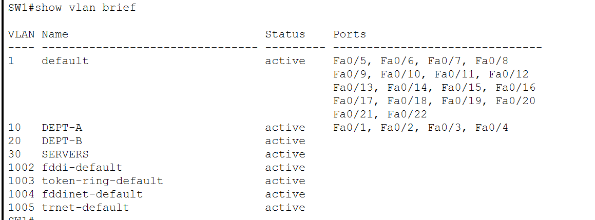

*Figure 10. EtherChannel between the department switches (LACP, both ports bundled).*

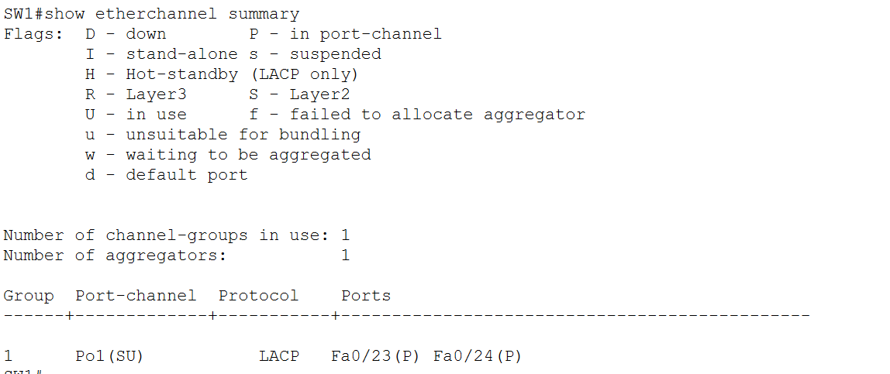

### Routers and HSRP

R1 can reach R2's Dept A address:

```text
R1# ping 192.168.0.14

Type escape sequence to abort.
Sending 5, 100-byte ICMP Echos to 192.168.0.14, timeout is 2 seconds:
.!!!!
Success rate is 80 percent (4/5), round-trip min/avg/max = 0/0/0 ms
```

R1 interfaces. This output was captured before the firewall segment was configured, which is why Gi0/1 still shows administratively down here:

```text
R1# show ip interface brief
Interface              IP-Address      OK? Method Status                Protocol
GigabitEthernet0/0     unassigned      YES unset  up                    up
GigabitEthernet0/0.10  192.168.0.13    YES manual up                    up
GigabitEthernet0/0.20  192.168.0.29    YES manual up                    up
GigabitEthernet0/0.30  192.168.0.45    YES manual up                    up
GigabitEthernet0/1     unassigned      YES unset  administratively down down
GigabitEthernet0/2     unassigned      YES unset  administratively down down
Vlan1                  unassigned      YES unset  administratively down down
```

R2 interfaces and HSRP state, captured at the same stage. R2 is Standby and sees R1 as Active for all three LAN groups:

```text
R2# show ip interface brief
Interface              IP-Address      OK? Method Status                Protocol
GigabitEthernet0/0     unassigned      YES unset  up                    up
GigabitEthernet0/0.10  192.168.0.14    YES manual up                    up
GigabitEthernet0/0.20  192.168.0.30    YES manual up                    up
GigabitEthernet0/0.30  192.168.0.46    YES manual up                    up
GigabitEthernet0/1     unassigned      YES unset  administratively down down
GigabitEthernet0/2     unassigned      YES unset  administratively down down
Vlan1                  unassigned      YES unset  administratively down down

R2# show standby brief
                     P indicates configured to preempt.
                     |
Interface   Grp  Pri P State    Active          Standby         Virtual IP
Gig         10   100 P Standby  192.168.0.13    local           192.168.0.1
Gig         20   100 P Standby  192.168.0.29    local           192.168.0.17
Gig         30   100 P Standby  192.168.0.45    local           192.168.0.33
```

After the firewall segment was added, group 40 appeared next to the three LAN groups:

*Figure 11. R1 is the active gateway for all four groups.*

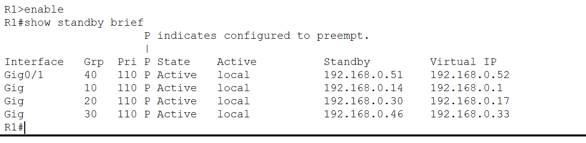

*Figure 12. R2 is the standby gateway for all four groups.*

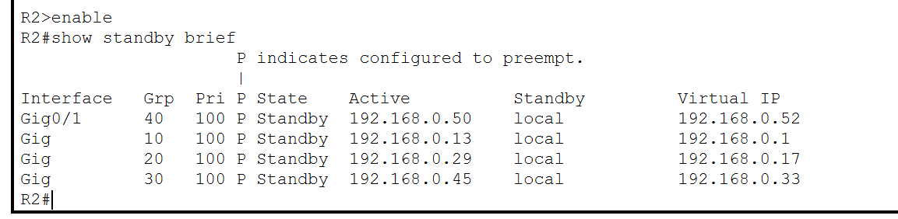

### Connectivity inside the office

Same department (PC1 to PC0). TTL=128 shows that no router was crossed:

*Figure 13. Same-department ping.*

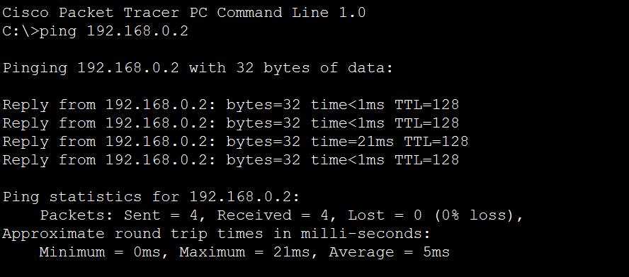

Between departments (PC1 to PC4). One request is lost to ARP, then the replies arrive with TTL=127:

*Figure 14. Inter-department ping through the HSRP gateway.*

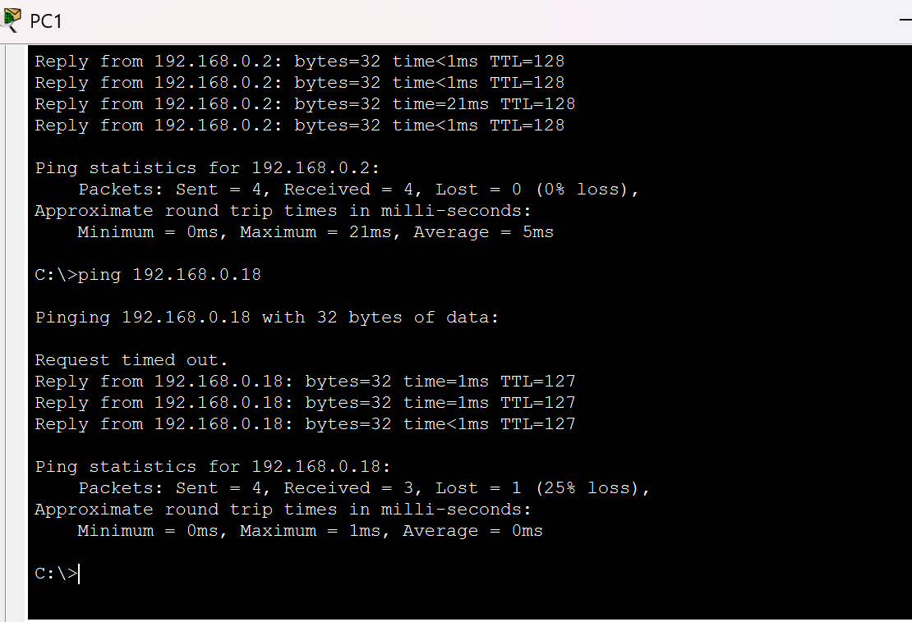

PC0 (Dept A) to the Web server. The two initial losses are ARP resolving twice, first from the PC to its gateway and then from the router to the server:

```text
C:\> ping 192.168.0.34

Pinging 192.168.0.34 with 32 bytes of data:

Request timed out.
Request timed out.
Reply from 192.168.0.34: bytes=32 time<1ms TTL=127
Reply from 192.168.0.34: bytes=32 time=2ms TTL=127

Ping statistics for 192.168.0.34:
    Packets: Sent = 4, Received = 2, Lost = 2 (50% loss),
Approximate round trip times in milli-seconds:
    Minimum = 0ms, Maximum = 2ms, Average = 1ms
```

A Dept A PC to the File/DNS server:

```text
C:\> ping 192.168.0.35

Pinging 192.168.0.35 with 32 bytes of data:

Request timed out.
Reply from 192.168.0.35: bytes=32 time<1ms TTL=127
Reply from 192.168.0.35: bytes=32 time<1ms TTL=127
Reply from 192.168.0.35: bytes=32 time=1ms TTL=127

Ping statistics for 192.168.0.35:
    Packets: Sent = 4, Received = 3, Lost = 1 (25% loss),
Approximate round trip times in milli-seconds:
    Minimum = 0ms, Maximum = 1ms, Average = 0ms
```

A Dept B PC to the File/DNS server:

```text
C:\> ping 192.168.0.35

Pinging 192.168.0.35 with 32 bytes of data:

Reply from 192.168.0.35: bytes=32 time<1ms TTL=127
Reply from 192.168.0.35: bytes=32 time=11ms TTL=127
Reply from 192.168.0.35: bytes=32 time<1ms TTL=127
Reply from 192.168.0.35: bytes=32 time<1ms TTL=127

Ping statistics for 192.168.0.35:
    Packets: Sent = 4, Received = 4, Lost = 0 (0% loss),
Approximate round trip times in milli-seconds:
    Minimum = 0ms, Maximum = 11ms, Average = 2ms
```

### DNS

A PC resolves `web.lab` through 192.168.0.35 and reaches the Web server:

```text
C:\> ping web.lab

Pinging 192.168.0.34 with 32 bytes of data:

Reply from 192.168.0.34: bytes=32 time<1ms TTL=127
Reply from 192.168.0.34: bytes=32 time<1ms TTL=127
Reply from 192.168.0.34: bytes=32 time=1ms TTL=127
Reply from 192.168.0.34: bytes=32 time<1ms TTL=127

Ping statistics for 192.168.0.34:
    Packets: Sent = 4, Received = 4, Lost = 0 (0% loss),
Approximate round trip times in milli-seconds:
    Minimum = 0ms, Maximum = 1ms, Average = 0ms
```

*Figure 15. The web server's page opened by name (`http://web.lab`) from PC1.*

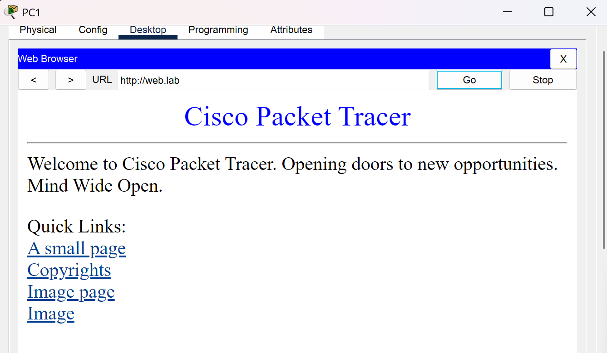

### Firewall and Internet

Before the Internet test, each link around the firewall was checked separately: the firewall reached the ISP (203.0.113.1, 4/5) and R1 (192.168.0.50, 5/5), and PC0 reached the group 40 virtual gateway (192.168.0.52, 4/4). After the fixes described under [Troubleshooting and lessons learned](#troubleshooting-and-lessons-learned), PC0 could ping the simulated Internet.

The first run lost its first three requests and the fourth was answered. The second run had no loss, and `show xlate` on the firewall shows the ICMP traffic translated by PAT from the inside host 192.168.0.2 (PC0) to the outside address 203.0.113.2.

*Figure 16. First ping from PC0 to the simulated Internet (198.51.100.1): three requests timed out, one reply arrived.*

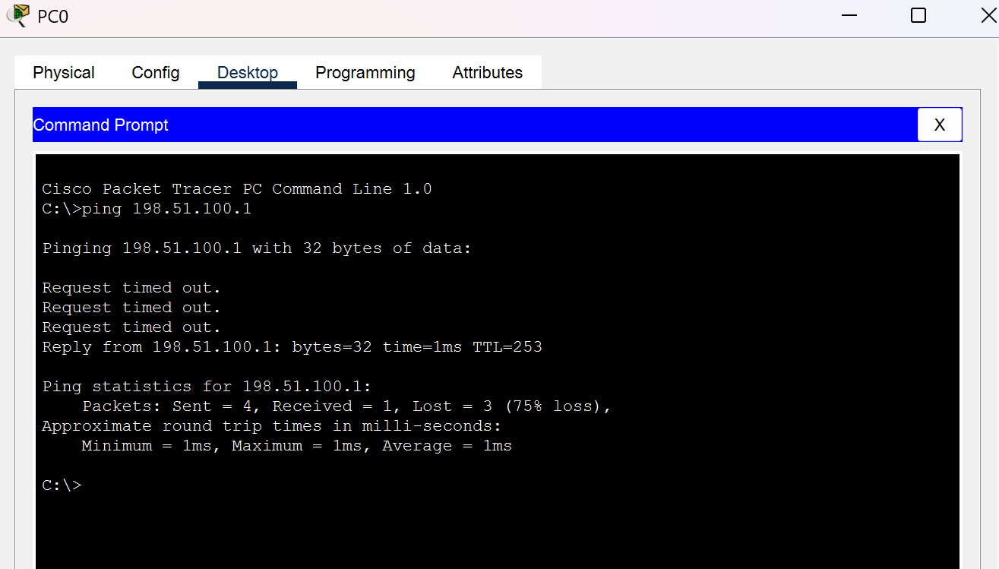

*Figure 17. Second ping from PC0 (0% loss), next to `show xlate` on the firewall.*

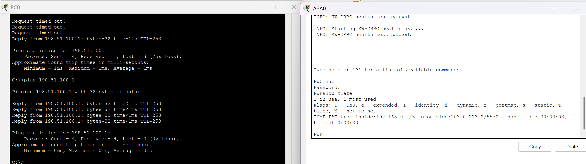

In the other direction, a ping from the ISP to the inside host 192.168.0.2 gets no reply. The ISP also has no route to the private addresses, so this result alone does not show whether the firewall policy or the missing route is the cause.

*Figure 18. A ping from the ISP to an inside host fails (0 of 5).*

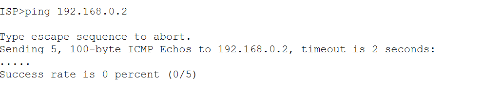

## HSRP failover test

This test shows that the PCs keep their gateway when the active router fails.

**Steps**

1. On a Dept A PC (PC0 in the screenshot), start a continuous ping to a Dept B PC so that the traffic goes through the gateway: `ping -t 192.168.0.18`
2. On R1, shut down the LAN interface:
   ```text
   configure terminal
   interface GigabitEthernet0/0
   shutdown
   ```
3. Check R2. It became Active for all three groups:
   ```text
   R2# show standby brief
                        P indicates configured to preempt.
                        |
   Interface   Grp  Pri P State    Active          Standby         Virtual IP
   Gig         10   100 P Active   local           unknown         192.168.0.1
   Gig         20   100 P Active   local           unknown         192.168.0.17
   Gig         30   100 P Active   local           unknown         192.168.0.33
   ```
4. On R1, bring the interface back with `no shutdown`. R1 has the higher priority (110) and `preempt`, so it becomes Active again.
5. Check R2 again. It is back to Standby with R1 as Active:
   ```text
   R2# show standby brief
                        P indicates configured to preempt.
                        |
   Interface   Grp  Pri P State    Active          Standby         Virtual IP
   Gig         10   100 P Standby  192.168.0.13    local           192.168.0.1
   Gig         20   100 P Standby  192.168.0.29    local           192.168.0.17
   Gig         30   100 P Standby  192.168.0.45    local           192.168.0.33
   ```

**Ping output during the test** (abridged: long runs of identical replies are shortened to `...`):

```text
C:\> ping -t 192.168.0.18

Pinging 192.168.0.18 with 32 bytes of data:

Reply from 192.168.0.18: bytes=32 time<1ms TTL=127
Reply from 192.168.0.18: bytes=32 time<1ms TTL=127
...
Request timed out.
Request timed out.
Request timed out.
Request timed out.
Reply from 192.168.0.18: bytes=32 time<1ms TTL=127
Reply from 192.168.0.18: bytes=32 time<1ms TTL=127
...

Ping statistics for 192.168.0.18:
    Packets: Sent = 89, Received = 85, Lost = 4 (5% loss),
Approximate round trip times in milli-seconds:
    Minimum = 0ms, Maximum = 11ms, Average = 0ms
```

**Interpretation.** There is one gap of 4 lost pings while HSRP moves the virtual gateway to R2, then replies resume without any change on the PC. No further loss was seen when R1 returned and preempted.

**Screenshot from a later run.** Figure 19 was captured after the firewall segment had been added. It shows the same four lost pings, and R2 becomes Active for group 40 (the transit segment) as well as for groups 10, 20 and 30. This is the interface tracking on R1 at work: when R1's Gi0/0 goes down, its group 40 priority drops and R2 takes over the virtual address 192.168.0.52.

**Scope of this test.** The pings go to an internal host (PC4). Internet access during a failover has not been tested.

*Figure 19. Failover from R1 to R2 during a continuous ping from PC0 to PC4. On the right, R2 reports Active for groups 40, 10, 20 and 30.*

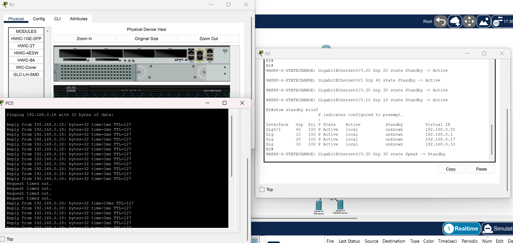

## Design decisions

- **VLANs.** A VLAN is a Layer 2 broadcast domain and a subnet is a Layer 3 address range; this design pairs them one-to-one. VLANs let a single trunk cable carry all departments, keep broadcast domains small, and force traffic between departments through the router, where it can be controlled. A VLAN does not create a subnet by itself. The subnet comes from the addresses configured on the hosts and on the router sub-interfaces.
- **Router-on-a-stick.** Each router uses one physical port (Gi0/0) as an 802.1Q trunk with sub-interfaces Gi0/0.10, Gi0/0.20 and Gi0/0.30, one per VLAN. This routes three VLANs without using three router ports.
- **HSRP.** R1 and R2 share the virtual gateways 192.168.0.1, .17, .33 and .52. Hosts only know the virtual address, so a router failure needs no change on any PC. R1 has priority 110 and R2 keeps the default 100, both with `preempt`, so R1 is active whenever it is healthy. Packet Tracer does not support VRRP, which is why HSRP is used.
- **EtherChannel.** The two department switches are joined by two links bundled as Port-channel 1 (LACP, mode `active`), giving more bandwidth and surviving the loss of one cable without a spanning-tree blocked port. FastEthernet ports Fa0/23 and Fa0/24 are used because the 2960-24TT has only two Gigabit ports, and both are taken (Gi0/1 to the router, Gi0/2 to SW-S1). Both ends use the same port numbers.
- **Servers in their own VLAN.** The servers are shared by both departments. Keeping them in VLAN 30 means all traffic to them passes the router, where it can be filtered.
- **Shared switch between the routers and the firewall.** With a direct cable from each router to the firewall, the firewall would have two separate paths and no way to know which router is currently the HSRP active one. After a failover it would keep sending return traffic to the wrong router. Putting R1, R2 and the firewall on one segment lets HSRP group 40 present a single next hop (192.168.0.52). The trade-off is that SW-FW is a single point of failure. In the final build the firewall's route points at R1's real address instead (see [Troubleshooting and lessons learned](#troubleshooting-and-lessons-learned)), so this benefit is prepared on the routers but not yet used by the firewall.
- **Firewall.** The ASA 5506-X is the closest Packet Tracer device to the "firewall, NAT/PAT, default-deny" box in the target design. Security levels give default-deny and PAT lets all inside hosts share one outside address.
- **ISP as a router with a loopback.** A 2911 with Loopback0 (198.51.100.1) gives a simple, reachable "Internet" address to test against, which is easier to reason about than Packet Tracer's Cloud device.

## Troubleshooting and lessons learned

### Internet pings timed out after the firewall was configured

**Symptom.** Pings from PC0 to 198.51.100.1 and 203.0.113.1 timed out, although the firewall itself could ping both the ISP and R1.

**Evidence gathered**

| Check | Observation | Meaning |
|---|---|---|
| Traceroute from PC0 | Reached 192.168.0.13 (R1), then 192.168.0.49 (FW), then timed out | The outbound path as far as the firewall is correct |
| `debug ip icmp` on the ISP | Echo replies were sent to 203.0.113.2 | The ping reached the ISP and NAT had rewritten the source address correctly |
| `show nat` on the FW | Across 8 test pings, translate_hits rose from 103 to 111 and untranslate_hits from 102 to 110 | Every reply came back to the firewall and was translated back |
| Packet Tracer Simulation mode | The returning reply showed a red X at the firewall | The reply was dropped at the firewall on its way back in |

**Conclusion.** The ISP and outbound NAT were fine. The echo reply was being dropped at the firewall on the return path.

**Fixes applied**

(a) Point the firewall's inside route at R1's real address instead of the HSRP virtual address:

```text
no route inside 192.168.0.0 255.255.255.192 192.168.0.52
route inside 192.168.0.0 255.255.255.192 192.168.0.50
```

Trade-off: return traffic from the Internet then depends on R1 and does not fail over to R2.

(b) Explicitly permit returning echo replies on the outside interface, with everything else from outside still denied:

```text
access-list OUTSIDE-IN extended permit icmp any any echo-reply
access-group OUTSIDE-IN in interface outside
```

**Result.** Both changes were applied, and PC0 could then ping the simulated Internet (see Figures 16 and 17).

### Smaller lessons from the build

- **Check the device type, not just the icon.** A 2911 router was first placed where the server switch belonged, and a 2960 switch was first used as the ISP, which cannot work because a Layer 2 switch has no routed ports. Both were replaced with the correct device.
- **Check the prompt before pasting.** Router commands were once pasted into the switches. The giveaway was that the commands did not fit the device: routers have no FastEthernet access ports or Port-channel.
- **`show` commands need privileged mode.** `show standby brief` and the others only work at the `#` prompt, after `enable`.
- **The first ping often fails.** One or two initial timeouts are ARP resolving, not a fault. Run the ping a second time before investigating.

## Implemented vs planned

The project started from a larger target design: Internet, a firewall, two routers with a virtual gateway (HSRP/VRRP), a main and a backup switch for each department, an EtherChannel, two server switches, and a second network card (teaming) on PCs and servers. The network was built as that design **without the backup connections**, because of Packet Tracer limitations. The IP addresses printed in the original diagram were not used; the /28 scheme above replaces them.

| Target design | As built |
|---|---|
| Virtual gateway with HSRP or VRRP | HSRP only (VRRP is not supported in Packet Tracer) |
| Backup switches SW1b and SW2b | Not built |
| Second NIC (teaming) on PCs and servers | Not built (PC-PT has one NIC) |
| EtherChannel between SW1b and SW2 | EtherChannel between SW1 and SW2 |
| Two linked server switches (SW-S1, SW-S2) | One server switch (SW-S1) |
| Firewall connected directly to each router | Connected through the shared switch SW-FW |
| Single firewall | Single firewall |
| IP addresses from the diagram | Own /28 scheme |

## Limitations

- **Single points of failure.** SW-FW and the firewall are not redundant. Each access switch is also the only path for its department, because the backup switches were not built.
- **Internet return traffic does not fail over.** The firewall's inside route points at R1's real address (192.168.0.50), so replies from the Internet depend on R1. HSRP group 40 with interface tracking is configured on the routers, but the firewall does not currently use its virtual address (192.168.0.52) as next hop.
- **Internet access during a failover is untested.** The failover test pings an internal host. Group 40 also moves to R2 in the later run (Figure 19), but the Internet path during a failover was not checked.
- **Minimal security policy.** The only access list is the one that permits returning ICMP echo replies on the firewall's outside interface. Inside the office there are no access lists, so the two departments can reach each other and the servers freely.
- **Unsecured management.** No passwords or SSH are configured on any device. This is acceptable for a lab file only.
- **Simulation.** Packet Tracer implements a subset of real device behaviour (no VRRP, for example), and timing such as the failover gap will differ on real hardware.

## Possible future improvements

- Add the backup switches (SW1b, SW2b) and the second server switch (SW-S2) from the target design.
- Add a second firewall so the Internet edge is redundant too.
- Use VRRP instead of HSRP on real hardware or in an emulator that supports it.
- Add access lists between the VLANs, for example to limit which hosts may reach the file server.
- Harden management access: enable secrets, local users, and SSH instead of an open console.
- Point the firewall's inside route back at the HSRP virtual address 192.168.0.52, so that Internet return traffic fails over to R2, then test and document Internet access during a router failover.

## Repository structure

```text
.
├── README.md
├── small-office-network.pkt
└── images/
    ├── fig01-topology.png
    ├── fig02-firewall-segment.png
    ├── fig03-pc3-ip-config.png
    ├── fig04-pc4-ip-config.png
    ├── fig05-web-server-settings.png
    ├── fig06-file-dns-server-ip-config.png
    ├── fig07-dns-service.png
    ├── fig08-http-service.png
    ├── fig09-sw1-show-vlan-brief.png
    ├── fig10-sw1-show-etherchannel-summary.png
    ├── fig11-r1-show-standby-brief.png
    ├── fig12-r2-show-standby-brief.png
    ├── fig13-ping-same-department.png
    ├── fig14-ping-inter-department.png
    ├── fig15-web-browser-web-lab.png
    ├── fig16-ping-internet-first-run.png
    ├── fig17-ping-internet-and-show-xlate.png
    ├── fig18-isp-ping-blocked.png
    └── fig19-hsrp-failover.png
```

## How to open the project

1. Install Cisco Packet Tracer (free through Cisco Networking Academy).
2. Download `small-office-network.pkt` from this repository and open it.
3. Wait until all link lights turn green, then run the checks in [How to reproduce and verify](#how-to-reproduce-and-verify).

## Author

**Noa Nemaz**, university student in computer science (networking, computer architecture, cybersecurity and systems).
