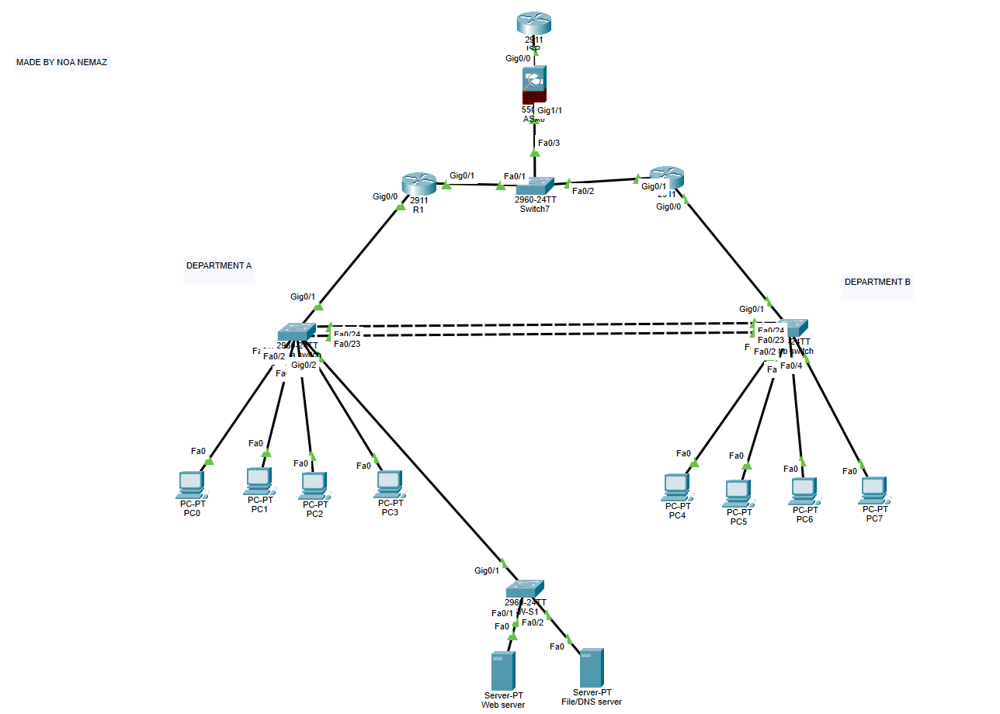

# Small Office Network

A two-department office network built and tested in **Cisco Packet Tracer**. It uses VLANs, redundant gateways (HSRP), an EtherChannel trunk, DNS/HTTP/FTP services, and a Cisco ASA firewall with NAT/PAT in front of a simulated Internet. Everything is a simulation.

## Highlights

- **VLAN segmentation:** Dept A (VLAN 10), Dept B (VLAN 20) and servers (VLAN 30), each in its own /28 subnet.
- **Inter-VLAN routing:** router-on-a-stick on two Cisco 2911 routers.
- **Gateway redundancy:** HSRP with R1 active and R2 standby. In the failover test, 4 of 89 pings were lost while R2 took over.
- **EtherChannel:** two LACP links between the department switches.
- **Services:** DNS (`web.lab`), HTTP and FTP on the server VLAN.
- **Firewall:** Cisco ASA 5506-X with PAT and default-deny towards a simulated ISP.
